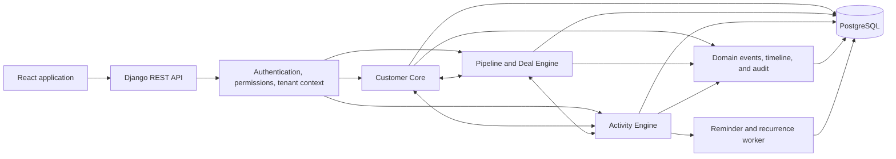

# ORION CRM Engine

ORION is Hammerload's configurable, multi-tenant CRM foundation. It models customer identity, commercial execution, and daily work as reusable domain systems instead of a collection of hardcoded screens.

[](https://github.com/orgalorg7/CrmTest/actions/workflows/ci-cd.yml)

The platform is designed to support different CRM shapes—real estate, automotive, agencies, B2B sales, healthcare, and future custom objects—without rewriting the core.

## What ORION Contains

### Module 01 — Customer Core

- First-class Leads, Contacts, and Companies
- Tenant-scoped ownership and teams
- Configurable lead sources and reusable tags
- Typed, validated custom fields
- Identity normalization for names, email, phone, and domains
- Duplicate detection with structured match reasons
- Deterministic lead scoring with score breakdowns
- Atomic lead-to-contact/company conversion
- Notes, structured timeline events, and audit history
- Search, composable filters, safe sorting, and bounded pagination
- Bulk actions, archive/restore, CSV import, and safe CSV export

### Module 02 — Sales Pipeline & Deal Engine

- Multiple configurable pipelines per tenant
- Ordered stages with stable `OPEN`, `WON`, and `LOST` semantics
- First-class Deals linked to customer records and ownership
- Transactional stage movement and cross-pipeline movement
- Structured stage history for cycle-time and conversion analysis
- Won, lost, and reopen lifecycle actions
- Tenant-configurable lost reasons
- Product catalog and snapshot-based deal line items
- Decimal money calculations, discounts, probabilities, and weighted value
- Deal contacts, tags, notes, custom fields, timeline, and audit integration
- Pipeline board, deal list, deal detail, settings, forecasts, and analytics

### Module 03 — Tasks, Activities & Work Execution

- Typed Tasks, Calls, Meetings, Follow-ups, and Reminders
- Assignment to users and teams with tenant validation
- Activity links to Leads, Contacts, Companies, and Deals
- Type-specific completion, cancellation, reopen, reschedule, and snooze actions
- Structured call and meeting outcomes
- Meeting attendees and schedule-conflict detection
- UTC persistence with explicit IANA timezone semantics
- Bounded RRULE recurrence with occurrence exceptions
- Idempotent, multi-instance-safe reminder claiming and dispatch handoff
- Structured activity history, audit records, timeline events, and domain events
- SLA deadline foundation, overdue calculations, and next/last-activity projections
- My Day, global activity list, calendar, quick create, and activity detail flows

### Existing Workspace Services

- Workspace registration, membership, invitations, roles, and organization switching
- English and Arabic localization with RTL-aware layouts
- Light and dark appearance modes
- Support tickets with comments and internal notes
- Employee and department management
- Operational dashboard analytics

## Architecture



ORION is a modular monolith. Business transitions live in explicit services and transactional use cases; HTTP handlers validate and serialize rather than owning domain logic. Shared infrastructure—tenancy, permissions, ownership, custom fields, tags, notes, timeline, events, and audit—is reused across modules.

### Backend

- Python 3.13+
- Django and Django REST Framework
- PostgreSQL in production and CI
- JWT authentication with tenant membership context
- Database transactions, constraints, row locking, and optimistic version checks where state races matter
- Indexed tenant-scoped queries and bounded APIs

### Frontend

- React and TypeScript
- Vite
- TanStack Query for server state
- Zustand for client state
- React Router with URL-backed list and filter state
- dnd-kit for accessible pipeline movement
- English/Arabic internationalization and RTL support
- Shared ORION components for records, activities, timelines, and empty/loading/error states

## Core Guarantees

### Tenant isolation

The authenticated workspace is the security boundary. Browser-supplied tenant IDs are not trusted, foreign relationship IDs are validated against the active tenant, and persistence queries include tenant scope. This applies to records, search, duplicate detection, bulk actions, imports, exports, analytics, reminders, and workers.

### Commercial history

Won and lost are business outcomes, not deletion states. Stage transitions, conversion, ownership changes, activity completion, and other meaningful actions preserve structured history and emit stable events for future automation and analytics.

### Extensibility

System objects are first-class, but shared engines are object-aware rather than Lead-only or Deal-only. Custom fields retain typed, queryable values. Generic relationships and stable event contracts provide seams for future custom objects, support, ERP, messaging, automation, and AI modules.

### Bounded work

List, timeline, calendar, board, bulk, import, export, recurrence, and reminder operations are bounded. ORION does not require loading an entire tenant dataset into application memory or the browser.

## Repository Layout

```text
.
├── backend/                 Django API, domain services, migrations, and tests
├── frontend/                React application and frontend tests
├── .github/workflows/       CI/CD pipeline
├── Dockerfile               Production web/worker image
└── run.sh                   Local development launcher
```

## Run Locally

### Prerequisites

- Python 3.13+
- Node.js 22+
- PostgreSQL 16+ for production-parity development
- `uv` or `pip`

### One-command development startup

```bash
./run.sh
```

The launcher prepares the backend, applies migrations, seeds development data, and starts:

- API: `http://localhost:8000`
- Frontend: `http://localhost:5173`

Development seed credentials are printed by the seed command. Never reuse seeded credentials in a deployed environment.

### Manual backend setup

```bash
cd backend
cp .env.example .env
python -m venv .venv
source .venv/bin/activate
pip install -r requirements.txt
python manage.py migrate
python manage.py seed_demo
python manage.py runserver
```

### Manual frontend setup

```bash
cd frontend
cp .env.example .env
npm ci
npm run dev
```

## Configuration

Backend configuration starts from [`backend/.env.example`](backend/.env.example). Important production settings include:

| Variable | Purpose |
| --- | --- |
| `SECRET_KEY` | Django signing secret; must be replaced in production |
| `DEBUG` | Must be `False` in production |
| `ALLOWED_HOSTS` | Comma-separated public application hosts |
| `CSRF_TRUSTED_ORIGINS` | Trusted HTTPS origins for browser requests |
| `DATABASE_URL` | PostgreSQL connection URL |
| `CORS_ALLOWED_ORIGINS` | Allowed frontend origins |
| `SECURE_SSL_REDIRECT` | Enables HTTPS redirects behind the trusted proxy |

Frontend configuration starts from [`frontend/.env.example`](frontend/.env.example):

| Variable | Purpose |
| --- | --- |
| `VITE_API_URL` | Public ORION API base URL |

## API Surface

The API is mounted below `/api/v1/` and follows consistent authentication, validation, tenant scoping, error, filtering, sorting, and pagination conventions. Principal resources include:

- `/api/v1/leads/`, `/api/v1/contacts/`, `/api/v1/companies/`
- `/api/v1/tags/`, `/api/v1/custom-fields/`, `/api/v1/notes/`
- `/api/v1/imports/`, `/api/v1/exports/`
- `/api/v1/pipelines/`, `/api/v1/deals/`, `/api/v1/products/`, `/api/v1/lost-reasons/`
- `/api/v1/forecasts/`, `/api/v1/pipeline-analytics/`
- `/api/v1/activities/`, `/api/v1/activity-outcomes/`, `/api/v1/activity-recurrence-series/`

Lifecycle actions use dedicated endpoints and services instead of unrestricted field mutation. Examples include lead conversion, deal movement, mark won/lost, activity completion, rescheduling, and recurrence edits.

## Activity Worker

The production image can run either the web process or the database-coordinated activity worker.

```bash
docker run --env-file backend/.env -e PROCESS_TYPE=activity-worker orion-crm
```

The worker processes bounded recurrence and reminder batches. Database claiming and unique constraints make retries and multiple replicas safe. Reminder processing creates an idempotent notification handoff; it does not embed SMTP, push, or messaging providers in the activity domain.

## Validation

Run the backend suite:

```bash
cd backend
python manage.py test
```

Run frontend checks:

```bash
cd frontend
npm ci
npm run typecheck
npm run lint
npm test -- --run
npm run build
```

Validate the production container:

```bash
docker build -t orion-crm .
```

The current suite covers normalization, scoring, custom-field validation, filters, customer records, conversion, deals, stage transitions, line items, analytics, activity lifecycle, recurrence, reminders, timezone behavior, tenant isolation, hostile ID access, unsafe relationships, import/export safety, and concurrency-sensitive actions.

## CI/CD

[`ci-cd.yml`](.github/workflows/ci-cd.yml) runs on pushes and pull requests to `main`:

1. Django system, security, and migration checks
2. Backend tests against PostgreSQL 16
3. Frontend typecheck, lint, tests, and production build
4. Docker image build validation
5. On successful `main` builds, production image publication to GitHub Container Registry

Published images:

```text
ghcr.io/orgalorg7/crmtest:latest
ghcr.io/orgalorg7/crmtest:main
ghcr.io/orgalorg7/crmtest:<commit-sha>
```

Container publication includes build provenance and an SBOM. Railway deploys from the repository's production Docker configuration.

## Production Deployment

The Docker image runs migrations before starting Gunicorn. Deploy the worker as a separate service using the same image and database with `PROCESS_TYPE=activity-worker`.

Before exposing ORION publicly:

- provision PostgreSQL and set `DATABASE_URL`;
- replace `SECRET_KEY` and disable debug mode;
- set allowed hosts, trusted origins, and CORS origins explicitly;
- configure web and worker health/observability;
- back up the database and verify migration rollback procedures;
- create real tenant administrators instead of deploying seed credentials.

## Integration Boundaries

ORION intentionally emits compact domain events rather than coupling modules to future consumers. Those contracts are the integration points for:

- Automations and webhooks
- Email, WhatsApp, SMS, and notifications
- Sales and operational analytics
- AI copilots and agents
- Support, quotes, invoices, and contracts
- ERP and e-commerce integrations
- Customer 360 projections

The current repository implements the CRM core. It does not claim fake external providers, inventory management, a notification delivery network, or an AI forecasting engine.

---

Built by Hammerload as the foundation for configurable, operational CRM products.
